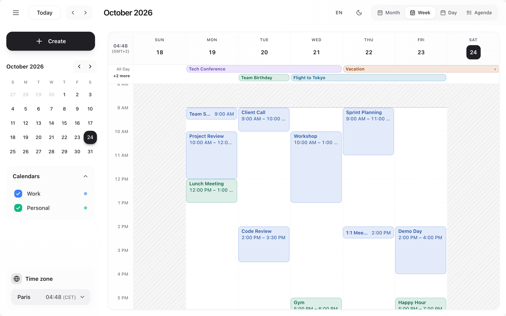
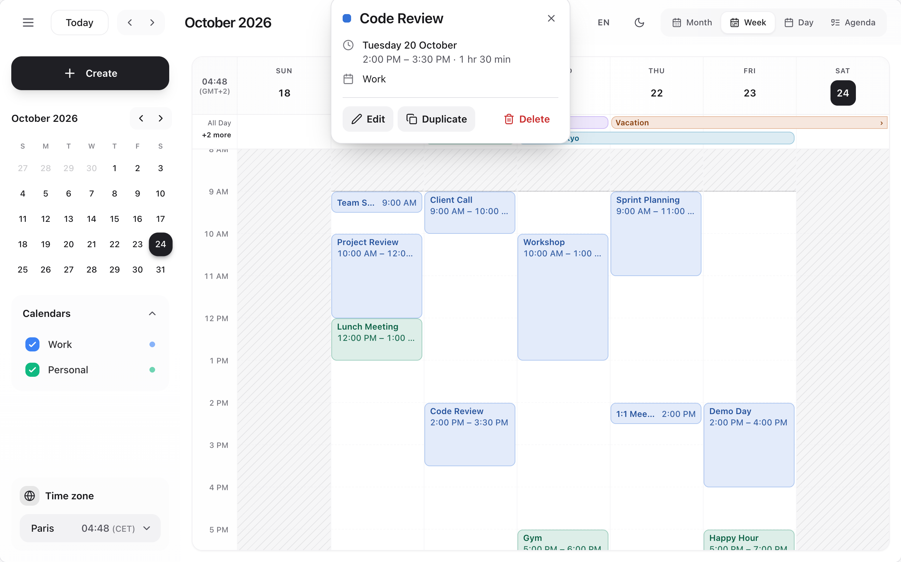
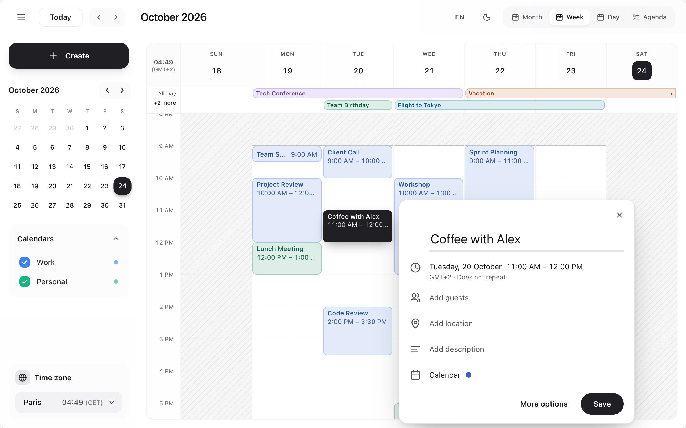
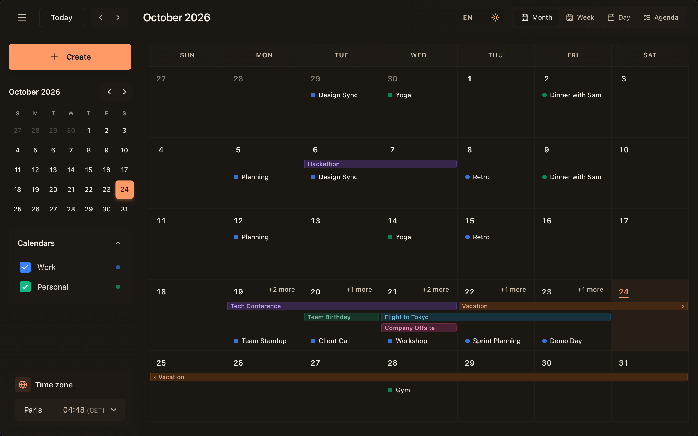
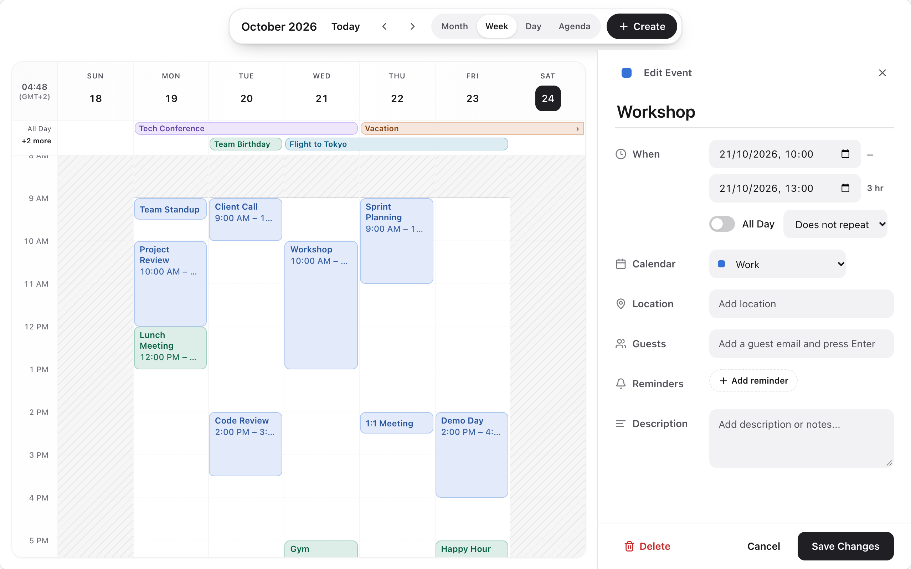
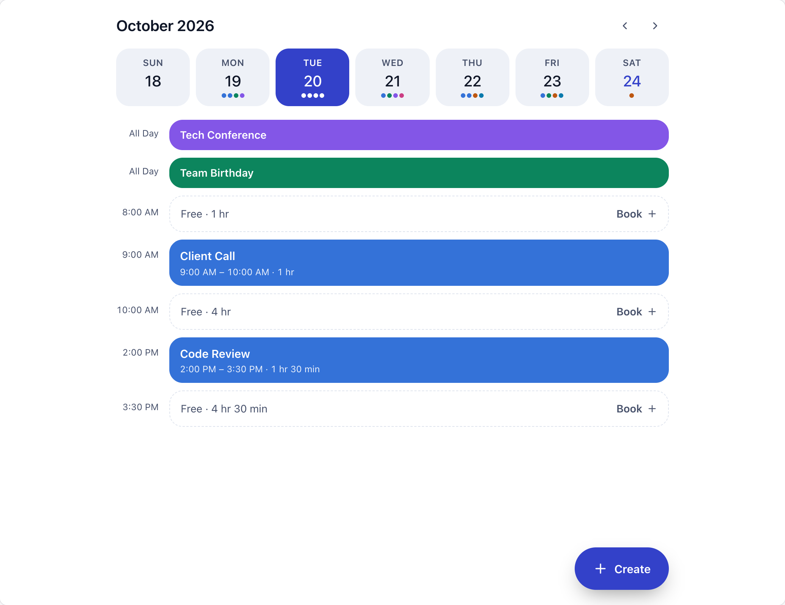
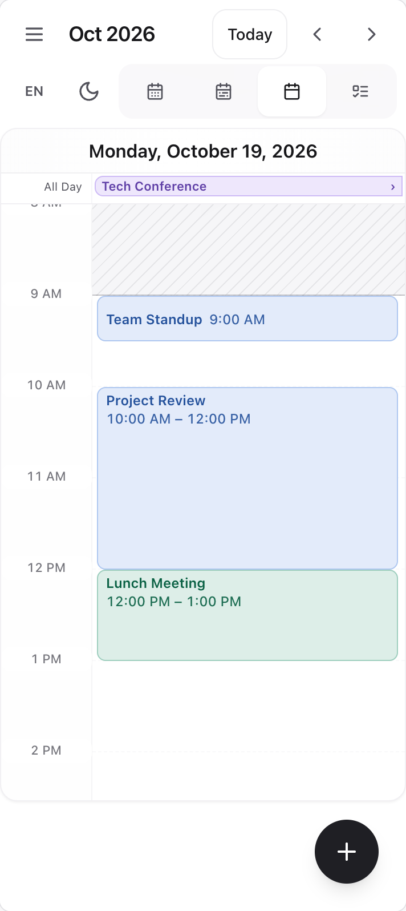
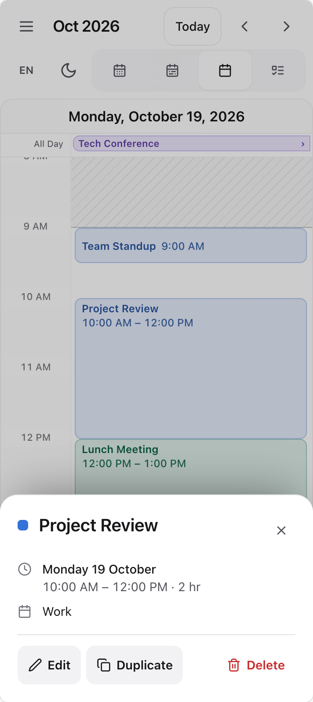

<div align="center">

# CalendarKit Pro

**A complete, accessible calendar for React: week, month, day, agenda and resource views, drag and drop, recurring events, time zones, three layouts and a phone layout. One component, its own styles, no setup.**

[](https://www.npmjs.com/package/calendarkit-pro)
[](https://www.npmjs.com/package/calendarkit-pro?activeTab=versions)
[](https://www.npmjs.com/package/calendarkit-pro)
[](docs/api.md)
[](LICENSE)

[Guide](docs/guide.md) · [API reference](docs/api.md) · [Changelog](CHANGELOG.md) · [Migrating from 1.x](MIGRATION.md)



</div>

## Features

- **Five views.** Month, week, day, agenda and resource timeline, with all-day and multi-day bars and overlapping events laid out side by side.
- **Create in place.** Click or drag over free time and type a sentence ("Lunch with Lea tomorrow 1pm for 2h"): the quick card understands it, in English and French. Every change can be undone.
- **Drag and drop.** Move events across days and resources, stretch them, snap to your slot size.
- **Recurring events.** Daily to yearly rules, single occurrences removed, wall-clock times kept across daylight saving.
- **Time zones.** Any IANA zone for display, all-day events never shifted.
- **Three layouts.** Classic, Focus (the grid under a floating toolbar, editing in a side panel) and Flow (a day feed with free slots to book).
- **Phones and narrow columns.** Under 768 px of calendar width: day view, drawer, bottom sheets, 44 px targets.
- **Accessible.** Every event and slot is a named button; dialogs trap and return the focus; no keyboard shortcuts to learn.
- **Themes.** Calm, Vivid and Editorial, light and dark, every colour a CSS variable, WCAG AA contrast on event colours.
- **Place search.** Optional Location suggestions from OpenStreetMap, or any provider.
- **Zero setup.** Ships its compiled, scoped stylesheet: no Tailwind, no CSS to import, nothing leaks into your page.
- **Built for real apps.** TypeScript types, server rendering (React 18 and 19), 10,000 events, a headless core for custom UIs.

## Screenshots

<table>
  <tr>
    <td width="50%"><br /><sub><b>Event card</b>, beside the event it belongs to</sub></td>
    <td width="50%"><br /><sub><b>Quick create</b>, in place, from a click or a drag</sub></td>
  </tr>
  <tr>
    <td><br /><sub><b>Month</b>, Editorial theme in dark mode</sub></td>
    <td><br /><sub><b>Focus layout</b>, editing in a docked panel</sub></td>
  </tr>
  <tr>
    <td><br /><sub><b>Flow layout</b>, the day as a feed, Vivid theme</sub></td>
    <td>
      
      
      <br /><sub><b>Phone layout</b>, with bottom sheets</sub>
    </td>
  </tr>
</table>

## Installation

```bash
npm install calendarkit-pro
```

React 18 or 19 is the only requirement. Upgrading from 1.x? See [MIGRATION.md](MIGRATION.md).

## Quick start

Give the calendar its events and let it keep them. That is the whole setup: the styles come with the component.

```tsx
import { Scheduler } from 'calendarkit-pro';

const events = [
  { id: '1', title: 'Design review', start: new Date(2026, 9, 15, 10), end: new Date(2026, 9, 15, 11) },
  { id: '2', title: 'Offsite', start: new Date(2026, 9, 19), end: new Date(2026, 9, 21), allDay: true },
];

export function MyCalendar() {
  return (
    <div style={{ height: 720 }}>
      <Scheduler defaultEvents={events} onEventsChange={(next) => save(next)} />
    </div>
  );
}
```

The calendar fills its parent: give the parent a height. `onEventsChange` receives the full list after every create, edit, move, resize, duplicate, delete or undo.

### Keeping the events in your state

To own the list (to sync it with an API, for example), pass `events` and update it from the callbacks:

```tsx
import { useState } from 'react';
import { Scheduler, type CalendarEvent } from 'calendarkit-pro';

export function MyCalendar() {
  const [events, setEvents] = useState<CalendarEvent[]>([]);

  return (
    <Scheduler
      events={events}
      onEventCreate={(event) => setEvents((list) => [...list, { ...event, id: crypto.randomUUID() } as CalendarEvent])}
      onEventUpdate={(event) => setEvents((list) => list.map((e) => (e.id === event.id ? event : e)))}
      onEventDelete={(id) => setEvents((list) => list.filter((e) => e.id !== id))}
    />
  );
}
```

### Next.js and server rendering

`calendarkit-pro` is marked `"use client"`, so it can be imported from a Server Component page. It renders on the server without touching `window`, and the page hydrates without a warning. Under a strict Content-Security-Policy, see [Styles and Content-Security-Policy](docs/guide.md#styles-and-content-security-policy).

## Usage

### Events

```ts
interface CalendarEvent {
  id: string;
  title: string;
  start: Date;          // also accepts ISO strings and timestamps
  end: Date;            // all-day events: exclusive (midnight after the last day)
  allDay?: boolean;
  calendarId?: string;  // takes the calendar's colour
  resourceId?: string;  // row in the resource view
  color?: string;
  location?: string;
  recurrence?: { freq: 'DAILY' | 'WEEKLY' | 'MONTHLY' | 'YEARLY'; interval?: number; count?: number; until?: Date };
  // … description, guests, reminders, attachments, place: see the API reference
}
```

### Views, layouts and the time grid

```tsx
<Scheduler
  view="week"                       // 'month' | 'week' | 'day' | 'agenda' | 'resource'
  layout="focus"                    // 'classic' | 'focus' | 'flow'
  dayStartHour={7}
  dayEndHour={20}
  slotDuration={30}
  workingHours={{ start: 9, end: 18 }}
/>
```

### Calendars, resources and time zones

```tsx
<Scheduler
  calendars={[
    { id: 'work', label: 'Work', color: '#3b82f6', active: true },
    { id: 'home', label: 'Personal', color: '#10b981', active: true },
  ]}
  resources={[{ id: 'room-a', label: 'Room A' }]}
  timezone="Europe/Paris"
/>
```

### Theming

```tsx
<Scheduler theme="editorial" mode="system" />
```

```css
.ck-root { --ck-primary: #0b7285; --ck-radius: 10px; }
```

### Customizing

```tsx
<Scheduler
  classNames={{ event: 'my-event', dialog: 'my-dialog' }}
  components={{ EventContent: ({ event }) => <strong>{event.title}</strong> }}
  renderEventForm={(props) => <MyEventForm {...props} />}
  language="fr"
/>
```

## Documentation

| | |
|---|---|
| [Guide](docs/guide.md) | Views, time grid, all-day and recurring events, layouts, creating and undoing, places, customizing, theming, time zones, i18n, resources, phones, accessibility, headless core |
| [API reference](docs/api.md) | Every prop, the exported types and entry points |
| [Migrating from 1.x](MIGRATION.md) | What changed in 2.0 and what to do about it |
| [Changelog](CHANGELOG.md) | Every release |

The package has four entry points: `calendarkit-pro` (the `<Scheduler>`), `calendarkit-pro/core` (the framework-free engine), `calendarkit-pro/react` (hooks and helpers to build your own calendar UI on it) and `calendarkit-pro/styles.css` (the stylesheet as a file).

## Browser support

The latest versions of Chrome, Edge, Firefox and Safari, on desktop and mobile.

## Contributing

Issues and pull requests are welcome on [GitHub](https://github.com/Zesor/calendarkit-pro/issues).

```bash
npm install
npm run dev        # the demo on http://localhost:3000
npm test           # unit tests (Vitest)
npm run ci         # typecheck, lint, tests, build, package checks, bundle size
```

`npm run test:dst` runs the suite on both clock changes of the year, and `node scripts/screenshots.mjs docs/images` refreshes these screenshots from the demo.

## License

[MIT](LICENSE)
